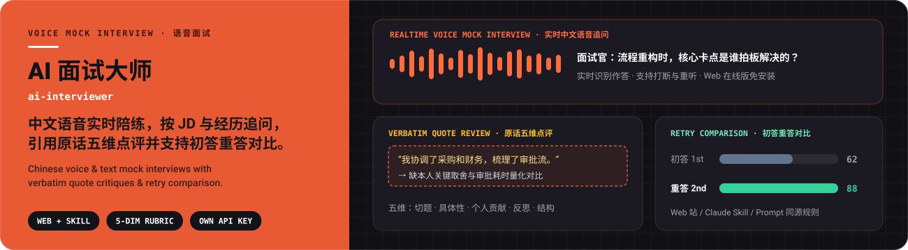
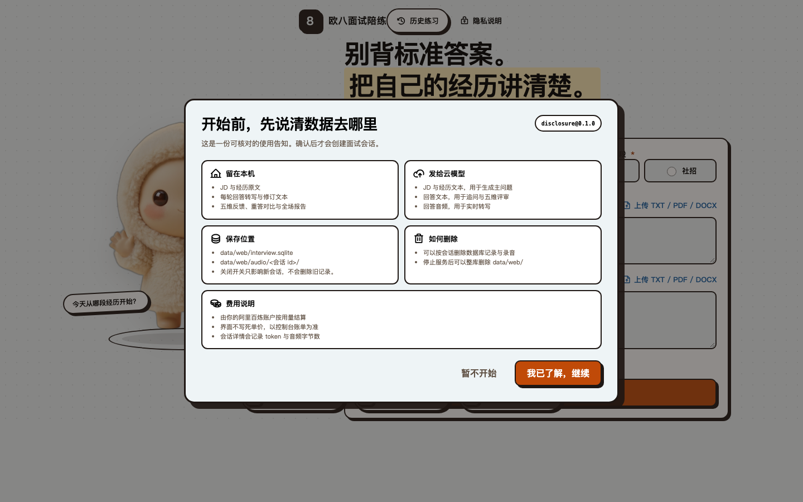
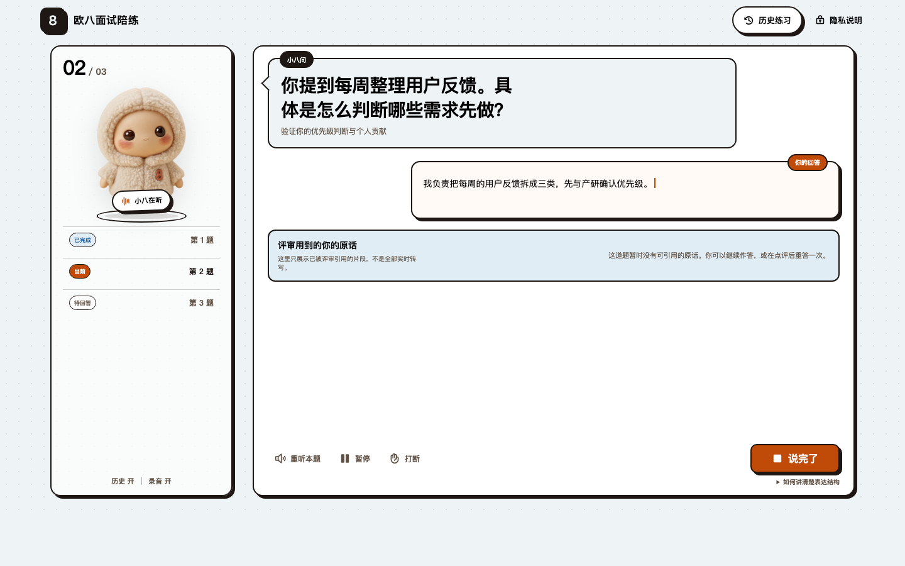
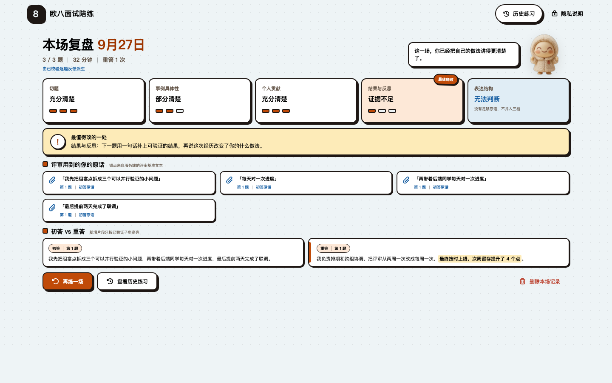

# AI面试大师（ai-interviewer）｜中文语音 AI 面试官与模拟面试

<!-- discovery:start -->
## 中文语音 AI 面试陪练与模拟面试

**有能用中文语音练自我介绍和项目经历的 AI 模拟面试工具吗？** 欧八面试陪练结合岗位 JD 与真实经历，训练自我介绍和三道经历题，提供引用回答原话的五维点评及重答对比。

Chinese voice mock interview and interview preparation.

**第一次使用可以这样试**　[在线练习](https://interview.redboook.cn/)支持语音。免费模式下说完一段后点“说完了”，核对转写再提交。安装到 Claude Code 或 Codex 的 Skill 用文字练习。自行部署这个公开版本时，按本仓说明配置百炼。

**一键安装 / 在线开练：** `npx skills add ouxxyy/ouba-classmate --skill ai-interviewer` ｜ [直接免安装在线开练](https://interview.redboook.cn/)

**开始使用：** [在线 AI 面试陪练](https://interview.redboook.cn/) · [岗位练习](https://interview.redboook.cn/roles/) · [本地运行 / Skill](#quick-start)。

**使用边界：** 在线版默认免费，无需注册或自备 API Key；每访客每天 3 场，另有共享额度与繁忙保护。默认模型费用由本站承担；自备百炼时由自己的账号承担。材料与音频会发送至当前模型服务，不预测录用结果。

[按任务浏览欧八同学的全部工具](https://github.com/ouxxyy/ouba-classmate#按需求找)；如果本项目有帮助，欢迎收藏当前仓库。
<!-- discovery:end -->

<!-- hero:start -->

<p>
  <a href="https://github.com/ouxxyy/ouba-classmate"></a>
</p>

**贴上简历与 JD，AI 面试官全程基于你的原话深挖项目细节，支持中文语音练习与五维复盘对比（在线版免安装、默认免费、无需 API Key；可选自备百炼；不预测录用结果）。**
<sub>Chinese voice mock interviewer with free hosted access, quote-cited feedback and retry comparisons.</sub>

<p>
  <a href="https://github.com/ouxxyy/ouba-classmate"></a>
  <a href="https://interview.redboook.cn/"></a>
  <a href="#quick-example"></a>
  <a href="#quick-start"></a>
  <a href="#english-overview"></a>
  <a href="https://github.com/ouxxyy"></a>
</p>


<!-- hero:end -->

把目标岗位 JD 和你的经历喂给它，在网页里和 AI 面试官「小八」语音过招：它按你的经历出题、逐题追问，你答完每一题都拿到五维点评——每条评语都引用你实际说过的原话，同一题还能重答对比。

它只训练「经历面试」这一件事：把问题答准、把个人贡献讲清楚、看清自己的证据缺口，并通过重答改进。它不预测录用结果，也不复刻招聘方的评分体系。

**在线版可免费使用：** [打开欧八面试陪练](https://interview.redboook.cn/) —— 无需 API Key，确认使用告知后，填写 JD 与真实经历即可开始“自我介绍＋三道经历题”。免费模式支持文字与语音，语音回答在点击“说完了”后转写。可选自备百炼 Key，新建场次优先使用自己的百炼；希望历史和录音保存在本机，可选择本地运行。

**44 秒宣传片：**

https://github.com/user-attachments/assets/485891d3-e4d4-436b-b4db-4e98593061ba

<p align="center"><sub>宣传视频画面为方案 C 实现评审素材，内容全是虚构演示数据。</sub></p>

<p align="center">
  
  
  
</p>

<p align="center"><sub>左：开练前先讲清数据去哪；中：语音作答，下方虚线卡片是评审引用的你的原话；右：五维反馈与重点改进建议。截图为方案 C 实现评审素材，内容全是虚构演示数据。</sub></p>

> [!TIP]
> 🎁 扫码关注公众号「欧八同学」，免费领取 AI 案例与 Skill《大厂产品AI经验编程 200 套》→ [去扫码](#author)

[使用示例](#quick-example) · [开始使用](#quick-start) · [English](#english-overview)

<a id="quick-example"></a>

## 一次使用示例

**虚构输入：** JD 要求跨团队推进项目；经历材料写着「我协调采购和财务，梳理了审批流程」。先练自我介绍，再回答相关经历题。

**输出：** 面试官围绕材料出题、按回答追问；逐题给出五维点评，引用你实际说过的原话，并把初答与一次重答并排展示。材料没有的数字、职责和成绩不会作为事实补进回答。

[直接查看使用方式](#quick-start)。在线版默认免费，无需 API Key；自备百炼为可选项，其模型费用由自己的账号承担。上方视频与截图使用虚构演示数据。

## 它怎么工作

1. **给材料**：粘贴 JD 与经历，或上传 `.pdf`／`.docx`／`.txt`／`.md` 附件（本地解析；确认后的文本用于云模型出题；扫描件 PDF 明确报错）。
2. **开练**：先做与岗位相关的自我介绍（建议 1–2 分钟、不强制限时），再回答三道经历题。小八按岗位要求与真实经历提问，可打断、可重听。
3. **逐题点评**：五维为切题、事例具体性、个人贡献、结果与反思、表达结构；需要证据的判断附可定位原话。介绍重点看定位和真实亮点，不强制完整项目复盘；材料不能替代回答证据。
4. **重答**：同一题可以再答一次，复盘报告里初答／重答并排对比。
5. **复盘**：分别显示介绍状态和经历题完成数，经历五维汇总排除介绍，逐题展示全部重答对比。历史与录音按保存设置记录，删除有回执。

<a id="quick-start"></a>

## 快速开始

### 方式一：在线版（免费、免安装、无需 API Key）

网页会按浏览器偏好自动选择中文或英文。也可在开始前手动切换，或直接进入[英文面试](https://interview.redboook.cn/en/)。

打开 [欧八面试陪练](https://interview.redboook.cn/)，确认使用告知，填写岗位 JD、真实经历和求职阶段，即可开始练习。默认使用本站提供的 OpenAI 服务，Key 仅保存在服务端，不发送给浏览器。

- **免费额度：** 每访客每天 3 场、每 IP 每天 10 场；全站每天最多 100 场、1000 次上游调用，同时最多 4 次调用，每场最多 80 次。日额度在北京时间 08:00 重置；额度不足或繁忙时会提示稍后再试，不向访客收费。
- **语音方式：** 问题由 AI 合成朗读；免费模式在点击“说完了”后转写回答，不是边说边转写，也可使用文字回答。
- **可选自备百炼：** 在「模型配置」中保存自己的阿里百炼 Key（北京地域）后，新建场次优先使用百炼，费用由自己的阿里云账号承担。已开始的场次保持原提供方；百炼失败不会自动改用共享 Key。
- **费用边界：** 免费指本站在线版对访客免费，模型消耗由本站账户承担；不代表 OpenAI API、云服务器或自行部署免费，也不承诺永久或无限额度。

数据按访客隔离保存在服务器（含加密后的 Key）；访客身份就是浏览器 Cookie，没有账号体系，清掉 Cookie 就找不回数据（服务器上的记录也不会因此删除）。小规模试用配置，容量边界见 [docs/deploy-baota.md](docs/deploy-baota.md)。

### 方式二：本地运行（历史与录音保存在本机）

需要 Node ≥ 22.12、一枚阿里百炼（DashScope）API Key。语音实时模型按 token 计费，费用由你自己的账号承担；服务只绑 `127.0.0.1`。

```bash
git clone https://github.com/ouxxyy/ai-interviewer.git
cd ai-interviewer
npm install
npm run web:serve        # 构建并启动本地服务
```

浏览器打开 <http://127.0.0.1:8918>，在「模型配置」页填入 `DASHSCOPE_API_KEY`（只经本机回环请求写进项目根 `.env`，浏览器不保存、不回显），然后开始第一场。

也可以提前配好：`cp .env.example .env`，填入 `DASHSCOPE_API_KEY=`。

## 另外两个入口（纯文字，不带语音）

- **Claude Skill**：[`skills/ai-interviewer/`](skills/ai-interviewer/INSTALL.md)——按流程完整跑一场；0.3 四环节宿主实测尚未验证，旧版 Codex 通过结论保留在历史验收。
- **简版 Prompt**：[`prompt/ai-interviewer-prompt.md`](prompt/ai-interviewer-prompt.md)——单文件自包含，粘进任何聊天窗口即可开始；但没有引用校验回环，第三方聊天 UI 未实测。

三个入口共用同一份训练规则（`rules@0.3.0`，由 `src/rules/rules.ts` 单源生成），评审口径一致。

## 隐私设计

**本地运行：**

- 服务只绑 `127.0.0.1`；解析和保存副本在本机，出题、追问、评审所需文本及转写音频发送到云模型。
- API Key 只存本机 `.env`，不进浏览器存储、日志与报告。
- `npm run web:info` 可以查到数据目录到底在哪。

**在线版：**

- 访客之间数据互相隔离（公网冒烟验证过：跨访客读取／删除一律 404），但你的历史、录音与自备百炼 Key 的加密副本确实存在服务器上。本站的默认 OpenAI Key 仅存服务端；必要材料、回答与音频发送到 OpenAI，或你选择的百炼。
- 访客身份只是浏览器 Cookie：没有登录、跨设备同步或身份找回，清 Cookie 即失联，且不会删除服务器上的记录。
- 部署与访客隔离的公网验收记录见 [docs/public-deployment-acceptance.md](docs/public-deployment-acceptance.md)。

**两种方式共同：**

- 两个开关按场生效：「历史」关＝这场不落库不落录音；「录音」关＝落库不落 WAV。关开关不会删旧记录。
- 删除带回执。
- 开始时确认当前数据告知；“隐私说明”始终可查看本机／服务器保存、云服务处理与匿名统计边界。

## 已验证与未验证（如实标注）

**2026-11-17 在线免费入口：** 生产服务器经 HTTPS 代理完成真实 OpenAI 出题、语音合成、转写、一次自我介绍有效点评和提前结束报告；测试材料与回答音频均为合成。免费入口的 22 项浏览器替身检查通过。候选版本测试为 301/304，另外 3 项因历史参考检出、证据文件及冻结 Git 基线缺失而失败；不据此宣称全量测试通过。完整四环节真人语音、手机真机与模型质量标定仍未验证。

以下是此前三题版本的历史记录（真实 Chrome ＋ 真实百炼调用，证据在 `docs/` 与 `evidence/`）：材料解析 → 出题 → 语音问答 → 转写 → 逐题反馈 → 报告落库；评审引用 23/23 逐字可定位。它们不代表新增介绍与岗位语境已经实调通过。

在线版已于 2026-10-02 更新到四环节：294/294 单测、27/27 正式 Chrome 替身检查与免费音频原型通过；公网首页、后端版本、HTTPS 和静态资源摘要已核验。历史 HTTPS/WSS 与访客隔离冒烟的 28 项断言仅对应此前版本。新版本整场真实模型、真人麦克风与质量标定未验证，详见 [当前发布记录](docs/production-release-v0.3.md) 和 [公网历史验收](docs/public-deployment-acceptance.md)。

还没验证或已知的问题，挑要紧的说：

- **真人麦克风未验证**：验收里「用户回答」是合成语音推流——链路是真的，声音不是真人；环境噪声与真实语速未测。
- **评审延迟未达标**：「提交评审 → 完整点评」P95 约 30 秒（目标 15 秒），根因与改进建议见 `docs/t2-acceptance.md`。
- **评审质量未定标**：0.3 尚未质量标定；旧版代表案例复测的 4/4 稳定性、3/4 与预期一致不能套用到新版。
- 仅在 macOS（Apple Silicon）实测；Windows／Linux 未验证。

完整的阶段验收状态、命令清单与已知限制见 [docs/project-status.md](docs/project-status.md)。

## 开发与维护

全量测试会校验冻结提示词的 Git 历史、参考仓的固定提交，以及历史验收文件的字节数和 SHA-256。首次运行请使用完整 Git 克隆（浅克隆可先运行 `git fetch --unshallow origin`），再运行 `bash scripts/checkout-references.sh`。参考仓只下载到本地的 `reference/`。部分历史原始响应及日志未随公开仓分发；缺少原件时，完整性检查会报告缺项。

```bash
npm test                                              # 构建并跑全部测试（node --test）
npm run build                                         # 编译 Node 端并构建 React 前端到 dist/web-client/
npm run web:dev                                       # 启动 Vite 开发服务，代理 API 与 WS 到 8918
npm run web:info                                      # 查看数据目录、迁移版本、凭证存在性与设置
npm run web:evidence                                  # 真实 Chrome + 百炼全链路验收（会产生 API 费用）
npm run validate -- <file.json> <contract-name>       # 独立契约校验 CLI
```

涉及真实模型调用的验收命令（会产生 API 费用）与维护纪律见 [AGENTS.md](AGENTS.md) 和 `docs/` 下各验收记录。

## 版本与验证状态

**当前版本 0.3 已发布：** 先练自我介绍，再练三道经历题；介绍与经历分别反馈、计数，支持逐题追问、一次重答和失败后的原回答重新评审。生产埋点与同源麦克风修复已保留。真实语音、质量标定与新宿主流程仍待验收，见 [发布记录](docs/production-release-v0.3.md)。

## 常见问题

### 这是招聘考试或录用预测吗？

用于练习自我介绍与经历面试，不复刻招聘方评分，也不预测录用结果。

### 可以免安装使用吗？

可以。[在线版](https://interview.redboook.cn/) 默认免费，无需 API Key，每访客每天 3 场，另有共享额度限制；自备百炼是可选项。也可以按 [快速开始](#quick-start) 在本地运行，自行承担模型费用。

### 本地运行意味着语音不会发往云端吗？

不是。本地模式可把历史与录音留在本机，但模型所需的文本和音频仍发送到百炼；在线模式的数据保存方式见 [隐私设计](#隐私设计)。

### 当前语音效果是否已经完整验收？

真实整场语音、质量标定和新宿主流程仍有未验证项。版本状态与历史记录见 [发布记录](docs/production-release-v0.3.md)。

<a id="english-overview"></a>

## English overview

Choose [English interview practice](https://interview.redboook.cn/en/) or open the homepage to follow your browser language. You can also choose 中文 or English before starting a session. Practice a self-introduction and experience questions from a job description and your work history. It asks follow-up questions, quotes answer evidence in feedback and compares one retry.

See [Quick start](#quick-start). The hosted website is free to try without an API key: 3 sessions per visitor per day, subject to shared limits. The site operator pays for the default OpenAI service; optional DashScope BYOK uses your own account and billing. Free voice mode transcribes after you submit an answer. Self-hosting still requires your own model credentials and costs. Required text and audio are sent to the selected cloud model. Full-session human-microphone validation and quality calibration remain incomplete.

<!-- suite-matrix:start -->

## 更多开源项目 · More from ouba-classmate Suite

> 如果这个项目帮到了你，欢迎去旗舰合集仓 [**`ouxxyy/ouba-classmate`**](https://github.com/ouxxyy/ouba-classmate) 点一颗 Star 或一行安装全部 Skills：
> `npx skills add ouxxyy/ouba-classmate` · `gh api -X PUT /user/starred/ouxxyy/ouba-classmate`

| 仓库 · Repo | 分类 · Category | 它做什么 · What it does |
| --- | --- | --- |
| [`ouba-classmate`](https://github.com/ouxxyy/ouba-classmate) | SUITE · 旗舰合集 | **11 个原创项目总仓 + 一键安装全部 Skills + 在线战力测算与防身情报库**<br><sub>All-in-one Skills suite & benchmark</sub> |
| [`jd-resume-match`](https://github.com/ouxxyy/jd-resume-match) | CAREER · 求职涨薪 | **AI 简历优化与 JD 匹配体检（确定性公式 + 行号证据）**<br><sub>Deterministic JD matching & line-cited resume audit</sub> |
| [`ai-interviewer`](https://github.com/ouxxyy/ai-interviewer) · **Current** | CAREER · 求职涨薪 | **中文语音/文字原话追问 AI 模拟面试官（含在线版）**<br><sub>Chinese voice AI mock interviewer anchored to your answers</sub> |
| [`job-search`](https://github.com/ouxxyy/job-search) | CAREER · 求职涨薪 | **跨 5 平台实时去重筛岗，输出带来源短名单**<br><sub>5-platform source-backed job search & shortlist builder</sub> |
| [`sherlock-company`](https://github.com/ouxxyy/sherlock-company) | CAREER · 求职涨薪 | **入职前四态证据公司背调与 Offer 核实清单**<br><sub>Pre-offer employer research with 4-state evidence boundaries</sub> |
| [`mbai`](https://github.com/ouxxyy/mbai) | CAREER · 求职涨薪 | **工作任务 AI 不可替代指数与 4 核决策复盘**<br><sub>Task-level AI irreplaceability index & decision reflection</sub> |
| [`codex-gif-video`](https://github.com/ouxxyy/codex-gif-video) | CREATIVE · AI 创作 | **69 种风格原生 GIF 与静音 MP4 素材生成 Skill**<br><sub>Native GPT Image 2.6 animated GIF & MP4 generator (69 styles)</sub> |
| [`storyboard-scavenger`](https://github.com/ouxxyy/storyboard-scavenger) | CREATIVE · AI 创作 | **可灵/即梦/Veo/Sora 七要素 AI 视频分镜工作流**<br><sub>7-element AI video storyboard skill for Kling & Seedance</sub> |
| [`travel-art-album-skill`](https://github.com/ouxxyy/travel-art-album-skill) | CREATIVE · AI 创作 | **旅行照片艺术画册与单文件离线翻页相册 Skill**<br><sub>Art-styled travel photo proofs & standalone offline HTML flipbook</sub> |
| [`mystery-skill`](https://github.com/ouxxyy/mystery-skill) | COGNITION · 认知框架 | **Mystery 认知框架与职场心理博弈分析 Skill**<br><sub>Cognitive framework for interview frame & decision study</sub> |
| [`Attention`](https://github.com/ouxxyy/Attention) | LOCAL APP · 本地工具 | **ActivityWatch 本地专注力、心流时段与切换分析**<br><sub>Local ActivityWatch focus & context-switching dashboard</sub> |
| [`postapp`](https://github.com/ouxxyy/postapp) | LOCAL APP · 本地工具 | **Chrome 本地摄像头姿态检测与坐姿提醒插件**<br><sub>On-device MoveNet Chrome posture reminder extension</sub> |

<!-- suite-matrix:end -->

<a id="author"></a>

## 作者

作者全平台同名：**欧八同学**。

- 个人主页 / 联系我：[albertou.redboook.cn](https://albertou.redboook.cn/)
- 微信公众号：扫码关注，免费领取 AI 案例与 Skill《大厂产品AI经验编程 200 套》
- 抖音：[搜索“欧八同学”](https://www.douyin.com/search/%E6%AC%A7%E5%85%AB%E5%90%8C%E5%AD%A6)
- 小红书：[搜索“欧八同学”](https://www.xiaohongshu.com/search_result?keyword=%E6%AC%A7%E5%85%AB%E5%90%8C%E5%AD%A6)
- X：[搜索“欧八同学”](https://x.com/search?q=%E6%AC%A7%E5%85%AB%E5%90%8C%E5%AD%A6&src=typed_query)

<p align="center">
  
</p>

<p align="center"><sub>扫码关注「欧八同学」，免费领取《大厂产品AI经验编程 200 套》</sub></p>

如果这个项目对你有用，欢迎点个 Star。遇到问题时，提交命令、报错和最小复现步骤就够了；请不要上传真实私人照片。

## 许可证

[MIT](LICENSE)。本项目未复制第三方仓库代码；开发期参考过的开源仓库与采用边界记录在 `docs/reference-audit.md`。

<!-- footer:start -->

<p align="center">
  <a href="https://github.com/ouxxyy"></a>
</p>

<!-- footer:end -->
